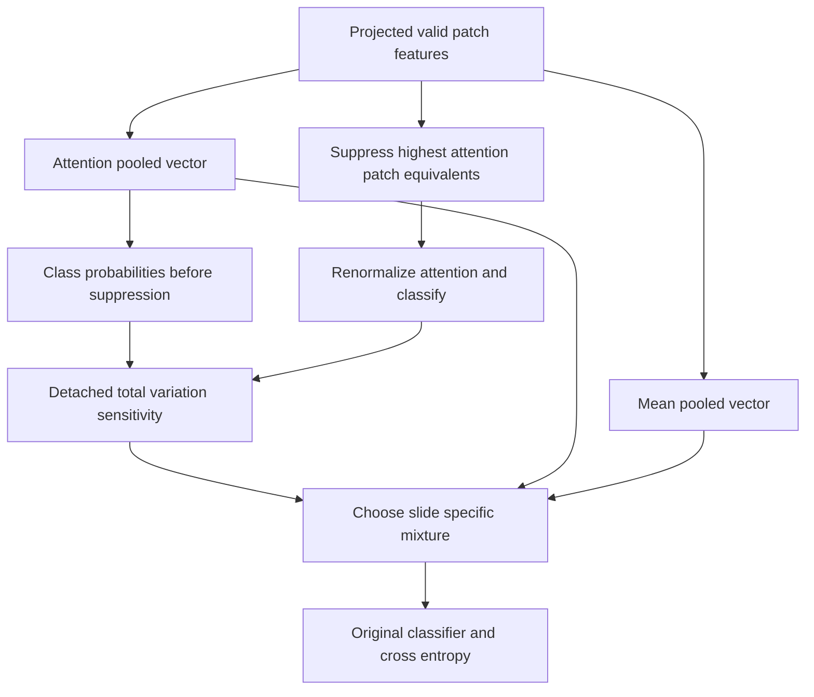

# Fragility guided adaptive pooling research

Decision recorded October 30 2026, after the full baseline results were known and before the new real-data pilot. This is a course research proposal and implementation, not a claim of a globally novel method or a prospective registration before all baseline test exposure.

## Research question

Can a slide's prediction sensitivity to suppressing high-attention patches usefully control how much uniform context enters its pooled representation, without adding trainable parameters?

The initial adaptive hybrid idea was a learned scalar or small gate blending attention and mean pooling. That remains a valid control, but a generic gate alone gives little explanatory research depth. The selected prototype ties adaptation to a defined, observable perturbation. It produces a per-slide diagnostic that can be evaluated against prediction correctness, class and patch count. It also has clear failure modes worth studying.

We cannot predict classmates' choices. Searching related papers cannot certify uniqueness or patent novelty. The defensible contribution is a documented adaptation and controlled study of this precise mechanism on the course features. Do not use “first,” “new state of the art,” or “causal explanation” to describe it.

## Definition

Start with exactly the ABMIL projection, attention and classifier. Let h_i be projected patch features, a_i their valid-patch attention and z_A = sum a_i h_i. Let z_M = sum h_i / N. The original classifier is g.

1. Score the unmodified bag and compute p_A = softmax(g(z_A)).
2. Set the diagnostic probe fraction to 0.10. For N > 1, suppress k = min(N-1, ceil(0.10 N)) highest-score patch equivalents. If multiple patches tie at the cutoff, suppress the same fraction of each tied patch so the budget is exactly k. This makes the operation symmetric under patch permutations. It is fractional suppression for a boundary tie, not always literal patch deletion. For N = 1, suppress nothing.
3. Recompute the attention normalization over the retained evidence using the original scores, yielding z_P and p_P = softmax(g(z_P)). For retained fraction r_i, probed attention is softmax(s_i + log r_i). Padded entries and completely suppressed entries receive zero weight. Using scores avoids numerical underflow from dividing tiny surviving probabilities.
4. Measure sensitivity by total variation: alpha = 0.5 sum_c |p_A,c - p_P,c|, a number between 0 and 1. No labels are used. Detach this diagnostic from the gradient graph.
5. Predict from z = (1-alpha) z_A + alpha z_M through the original classifier.

Ordinary slide cross-entropy trains the original ABMIL layers through z. The diagnostic gate is deterministic, not a learned MLP; it adapts separately to every slide during training and inference. There is no consistency penalty and no second learned attention branch. Stop-gradient means the optimizer does not directly differentiate through the sensitivity-to-alpha computation, although parameter updates change future diagnostics. This is an algorithmic choice to disclose, not a complete gradient of an end-to-end learned gate.

The actual effective pooling contribution is w_i = (1-alpha) a_i + alpha/N over valid patches. Raw returned attention still refers to the attention branch. There are zero added trainable parameters, two additional small classifier evaluations per forward, and one top-fraction selection per bag. Feature projection and gated patch scoring are computed once. Runtime must still be measured; no speed advantage is assumed.

## Why the direction is plausible and why it may fail

A large prediction change suggests dependence on a small selected portion of the observed evidence. A larger uniform contribution might reduce that dependence. This is a hypothesis, not proof that the removed evidence is spurious. A true small lesion can be the only diagnostic region; suppression should then change the prediction, and averaging more normal tissue may hurt. Mean features can also contain scanner or tissue composition shortcuts. A sensitivity score can be small for a confidently wrong model, or because probability softmax saturates. Repeated redundant disease patches can hide single-subset sensitivity. A ten-percent probe is an artificial intervention, not a validated model of real acquisition noise. These are central limitations, not details to omit if the results are negative.

Do not call alpha calibrated uncertainty, clinical reliability, a lesion probability or a causal effect. Correctness and perturbation stability are separate outcomes. High stability can simply mean the model ignores useful evidence.

## Related work checked

The following primary sources establish that masking, attention challenges and counterfactual reasoning are existing MIL research directions. The local design is inspired by this area and must cite it.

| Source | Relevant established idea | Difference in this prototype |
|---|---|---|
| [Ilse et al. 2018 ABMIL](https://proceedings.mlr.press/v80/ilse18a.html) | Learned permutation invariant attention aggregation | Reuses the same layers; adds a diagnostic controlled mixture. |
| [Tang et al. 2023 MHIM-MIL](https://openaccess.thecvf.com/content/ICCV2023/papers/Tang_Multiple_Instance_Learning_Framework_with_Masked_Hard_Instance_Mining_for_ICCV_2023_paper.pdf) | Attention-based instance masking with teacher/student hard-instance learning | No momentum teacher or masked-student training objective here. |
| [Zhang et al. 2024 ACMIL](https://www.ecva.net/papers/eccv_2024/papers_ECCV/html/6954_ECCV_2024_paper.php) | Multiple attention branches and stochastic top-K masking address concentrated attention | One attention branch; deterministic sensitivity adjusts pooling at training and inference. |
| [Chraki et al. 2026 CAR-MIL](https://arxiv.org/abs/2609.08419) | Learned factual and counterfactual attention branches with a regularization objective | No learned counterfactual branch or divergence objective; the suppression probe controls a mean mixture. |
| [Self-supervision enhances instance-based MIL 2025](https://pmc.ncbi.nlm.nih.gov/articles/PMC12134610/) | Studies several pooling operators including a trainable pooling mixture | Pooling mixtures are prior art; the hypothesis here concerns using evidence sensitivity as the control signal. |

Search scope included adaptive MIL pooling, attention masking, deletion sensitivity, fragility and counterfactual-guided attention. No exact match for this specific rule was identified in this limited search. That is not evidence that none exists. The distinctions above are our interpretation of the referenced methods, not claims that all possible related work has been excluded.

## Frozen initial settings and fair comparisons

- All datasets: supplied 384-dimensional features, exact original baseline split IDs, projection 256, attention hidden 128, batch size 1, seed 42, AdamW learning rate 1e-4, weight decay 1e-5, dropout 0, no scheduler or warmup, 30 epochs for a full run.
- Select the earliest epoch maximizing validation macro AUROC + macro F1, as before.
- Fix the probe fraction at 0.10 and the gate rule at alpha = total variation. Do not choose these by test performance. There is no hyperparameter sweep in this initial study.
- Main comparison: original ABMIL versus fragility-guided pooling on C16, C17 and BRACS. Reuse the completed ABMIL measurements.
- Recommended ablations: fixed 50/50 pooling and pure mean, with matched splits, initialization seed and optimizer. These distinguish adaptation from merely adding a uniform contribution. Do not call adaptation useful without these controls.
- Additional informative control if resources allow: replace each adaptive alpha with a single value estimated from training slides only. This controls the average amount of smoothing without slide-specific allocation. Not implemented yet.
- Debug runs: two epochs, validation only, explicitly not benchmarks and not used to select the best method. Synthetic fixtures only establish software behavior.
- No held-out inference during development. Full 30-epoch extension evaluation remains a separate step after implementation and protocol checks. The held-out baseline results have already been seen; disclose the chronology.
- C17's 27 shared train/validation patients remain a limitation. A patient-grouped sensitivity study would be a separate experiment, not a replacement of the preserved baseline table.

## Evaluation beyond a headline accuracy number

Report accuracy, macro AUROC, macro F1, cross-entropy, per-class recall and confusion matrices for all methods. Add learning curves and selected epochs. Save per-slide alpha, suppressed attention mass, patch count, attention-only probabilities and final probabilities. Summarize alpha separately on correct and incorrect predictions and check whether patch count or class dominates the signal. These are descriptive diagnostics, not a fitted calibration model.

For a later robustness study, freeze a set of random, top-attention and low-attention removals at fractions 0, 0.05, 0.10 and 0.20. Use the original ABMIL checkpoint to define a common removal set per slide so both models see the same perturbed bags. Save the exact subsets and random seed. Report clean performance, remaining accuracy, label flips and probability change together. Targeted deletion may remove genuine disease evidence, so degraded performance is not automatically a robustness failure and stability is not automatically desirable. This robustness evaluator is planned, not implemented in the initial prototype.

One seed cannot establish statistical superiority. Matched additional seeds are preferable if the deadline and CPU budget allow. Do not claim significance from point estimates.

## What would make the project stand out

The strongest deliverable is an honest mechanism study: a precise rule, preserved baseline, meaningful controls, careful error analysis, and evidence about when sensitivity-based adaptation helps or hurts. A concise negative finding about the sparse-evidence failure mode can be more defensible than an elaborate gate with an untested claim of novelty. The assignment explicitly allows negative results.

## Implementation map

- `../model_fragility.py`: parameter-matched model, stable suppression, symmetric ties and per-slide diagnostics.
- `train_extension.py`: separate training runner and controls; validation only; archives sources; checks real splits against the baseline.
- `test_fragility.py`: mathematical checks, gradients, padding/permutation invariance, numerical extremes and synthetic training on all three dataset formats.
- `analyze_validation.py`: validation diagnostic export for a saved research checkpoint.
- `evaluate_extension.py`: full-run held-out evaluator with snapshot checks and saved gate diagnostics; its public CLI rejects two-epoch runs.
- Completed baseline modules and held-out artifacts are not edited by this implementation.

The previously documented normalized attention entropy proposal remains the second research idea for the rubric. The original fixed mixture is retained as a control. This protocol supersedes an unspecified learned adaptive gate as the selected implementation direction; the October 29 report remains a historical baseline documentation snapshot.
