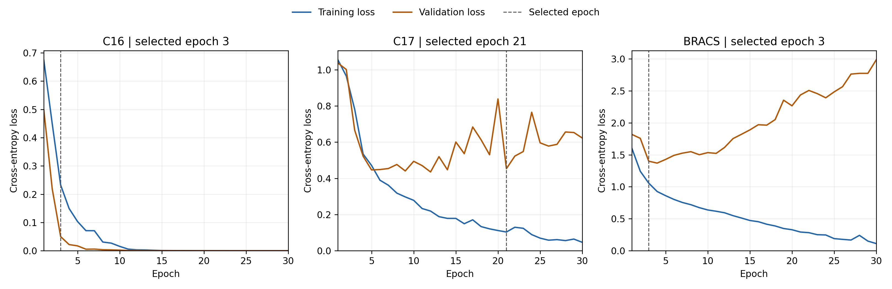

# ABMIL baseline evaluation

Generated October 29, 2026, 20:38 EDT.

All three baselines completed 30 epochs. Each held-out evaluation used the checkpoint selected solely by validation macro AUROC + macro F1 (earliest epoch in a tie). Test predictions were saved; this report recomputes metrics from those predictions without rerunning inference.

| Dataset | Train / validation / test slides | Selected epoch | Test accuracy (%) | Test macro AUROC | Test macro F1 | Test loss |
|---|---|---:|---:|---:|---:|---:|
| C16 | 242 / 27 / 129 | 3 | 88.37 | 0.9224 | 0.8714 | 0.2700 |
| C17 | 269 / 30 / 200 | 21 | 78.50 | 0.8226 | 0.5520 | 0.7969 |
| BRACS | 389 / 62 / 86 | 3 | 46.51 | 0.7855 | 0.3716 | 1.4110 |

## Learning curves

Each panel has its own loss scale. The dashed line is the epoch selected by validation AUROC + F1, not necessarily minimum validation loss.

## Model structure and component roles

The frozen image encoder is represented here by the supplied patch feature vectors. It supplies visual descriptions but is not updated during MIL training. A learned linear projection with ReLU transforms each 384-number patch vector into a 256-number representation.

Gated attention computes a score from the elementwise product of a tanh branch and a sigmoid branch, then normalises scores across valid patches with softmax. Padded patches receive zero attention. A weighted sum produces one slide representation; patch order does not affect this pooling operation.

The linear classifier maps the pooled representation to 2, 4 or 7 class logits. Cross-entropy trains the projection, attention and classifier together from slide labels. Class softmax is used during evaluation. Attention weights are pooling contributions, not patch-level tumour probabilities, and this baseline does not explicitly model spatial relationships between patches.

## Training procedure

- Supplied, frozen 384-dimensional patch features; no image encoder was trained in these experiments.
- Learned 384-to-256 projection with ReLU, gated attention with 128 hidden units, weighted pooling, and a linear classifier.
- Slide cross-entropy loss; AdamW with learning rate 0.0001 and weight decay 0.00001; batch size 1; dropout 0; seed 42; 30 epochs.
- CPU execution with two training threads. No scheduler or warmup was applied; the supplied warmup_epoch field is unused.
- Original slide IDs, split logic and class mappings were preserved. Every split contains all configured classes.
- Macro AUROC averages one-vs-rest class AUCs. Accuracy is a percentage; AUROC and F1 are on a 0-1 scale.

## Selected validation results and test comparison

| Dataset | Validation accuracy (%) | Validation AUROC | Validation macro F1 | Test majority-class accuracy (%) |
|---|---:|---:|---:|---:|
| C16 | 100.00 | 1.0000 | 1.0000 | 62.02 |
| C17 | 90.00 | 0.8854 | 0.7856 | 60.50 |
| BRACS | 56.45 | 0.8068 | 0.4429 | 23.26 |

The majority-class accuracy is a descriptive reference computed from the test labels; it was not used to select or train the model. Refer to macro F1 and the per-class confusion matrices as well as accuracy, especially for imbalanced datasets.

## Observed behaviour

- **C16:** selected validation macro F1 was 1.0000, compared with 0.8714 on test. The lowest test recall was class 1: 75.51% (37/49 slides correctly classified).
- **C17:** selected validation macro F1 was 0.7856, compared with 0.5520 on test. The lowest test recall was class 1: 12.50% (2/16 slides correctly classified).
  Later epochs show training/validation divergence: final training loss 0.0464, final validation loss 0.6225, and minimum validation loss 0.4352. This is consistent with overfitting in later training; the reported test result still uses the original validation-selected checkpoint, not the last epoch.
- **BRACS:** selected validation macro F1 was 0.4429, compared with 0.3716 on test. The lowest test recall was class 3: 0.00% (0/11 slides correctly classified).
  Later epochs show training/validation divergence: final training loss 0.1116, final validation loss 2.9865, and minimum validation loss 1.3701. This is consistent with overfitting in later training; the reported test result still uses the original validation-selected checkpoint, not the last epoch.

Class IDs follow the supplied feature labels and configured mappings. These observations identify errors and learning patterns; they do not establish their biological cause or localise lesions.

## Limitations and split units

- C17 has 27 patients shared between train and validation, 0 between train and test, and 0 between validation and test. Validation is not patient-independent. Test uses held-out centres under the supplied course split, rather than the original challenge's hidden test cohort.
- Results are slide-level, with multiple slides potentially belonging to one patient. No patient-level staging performance is claimed.
- One seed was run. No across-seed uncertainty, statistical significance or clinical generalisation is established.
- C16 validation contains only 27 slides; perfect validation results should not be treated as proof of perfect generalisation.
- The hybrid extension is excluded from this baseline table. Its real-data comparison remains a separate experiment with matching splits.

## Reproducibility and error analysis

Host CPU: Intel(R) Core(TM) i7-1065G7 CPU @ 1.30GHz (4 physical cores, 8 logical processors). Training used two CPU threads per process. All runs used Python 3.9.5 and PyTorch 2.8.0+cpu.

- C16: [C16_baseline_windows](../C16_baseline_windows/), [test confusion matrix](../C16_baseline_windows/heldout_test/confusion_matrix.png), [per-class metrics](../C16_baseline_windows/heldout_test/per_class_metrics.csv), [slide probabilities](../C16_baseline_windows/heldout_test/predictions.csv).
- C17: [C17_baseline_windows](../C17_baseline_windows/), [test confusion matrix](../C17_baseline_windows/heldout_test/confusion_matrix.png), [per-class metrics](../C17_baseline_windows/heldout_test/per_class_metrics.csv), [slide probabilities](../C17_baseline_windows/heldout_test/predictions.csv).
- BRACS: [BRACS_baseline_windows](../BRACS_baseline_windows/), [test confusion matrix](../BRACS_baseline_windows/heldout_test/confusion_matrix.png), [per-class metrics](../BRACS_baseline_windows/heldout_test/per_class_metrics.csv), [slide probabilities](../BRACS_baseline_windows/heldout_test/predictions.csv).

Each run includes its configuration, source fingerprints, dependency versions, split IDs, 30-epoch history and selected checkpoint. Each heldout_test folder records checkpoint/evaluator fingerprints, an evaluation plan, metrics, per-slide probabilities and per-class errors.

Baseline reference: Ilse, Tomczak and Welling, [Attention-based Deep Multiple Instance Learning](https://proceedings.mlr.press/v80/ilse18a.html), ICML 2018. Implementation is based on the supplied course scaffold with documented assistance.
